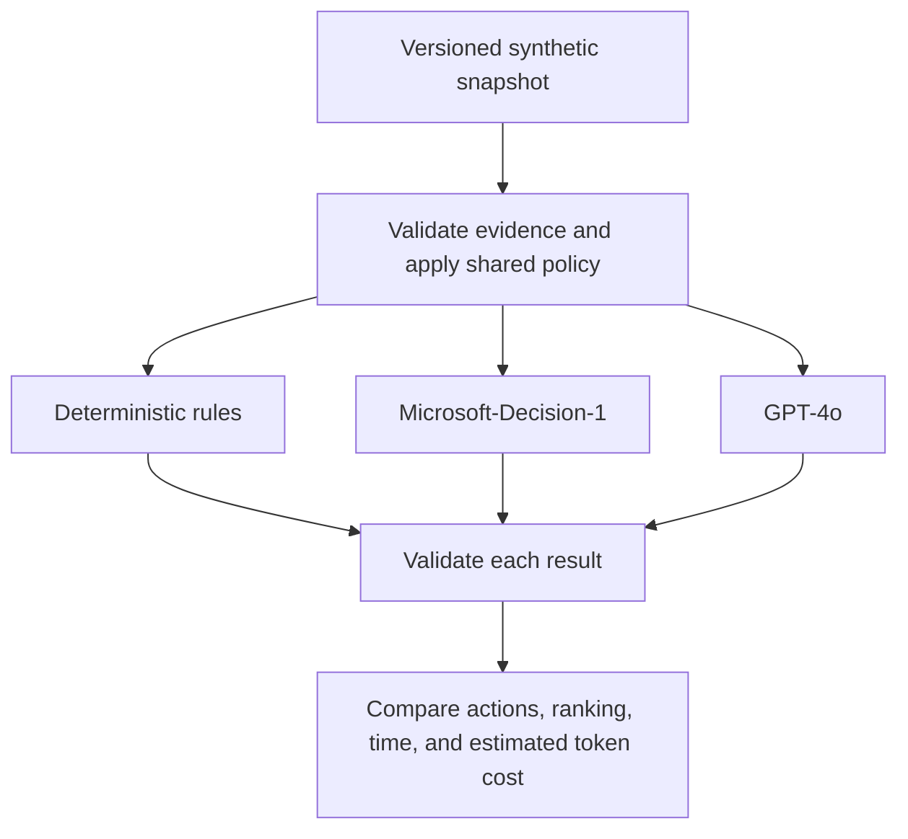
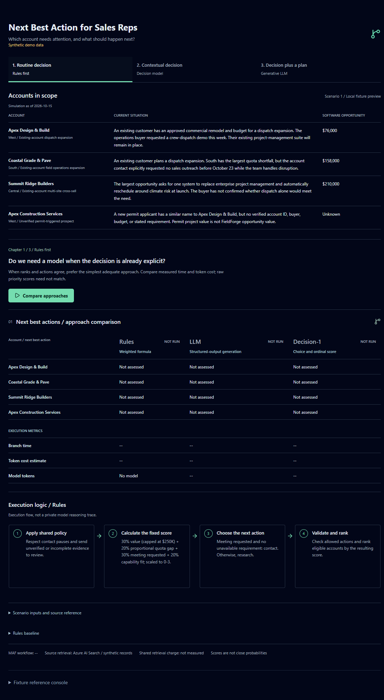
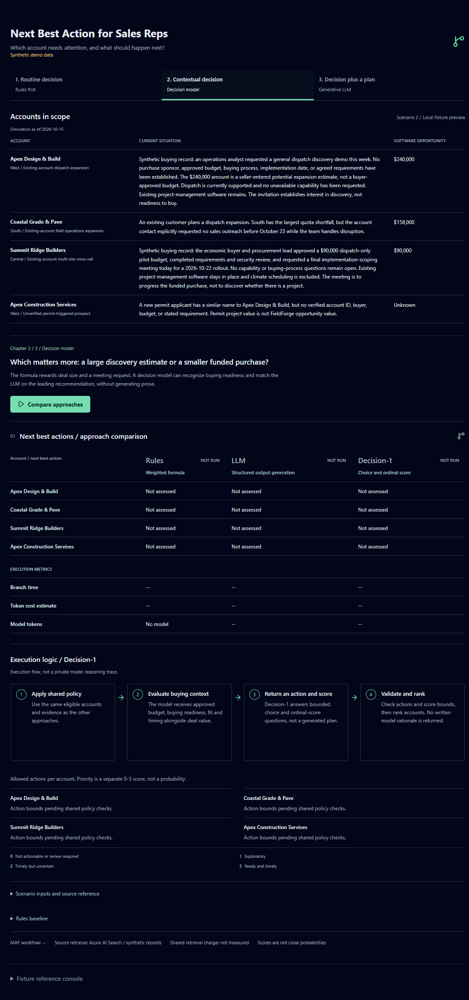
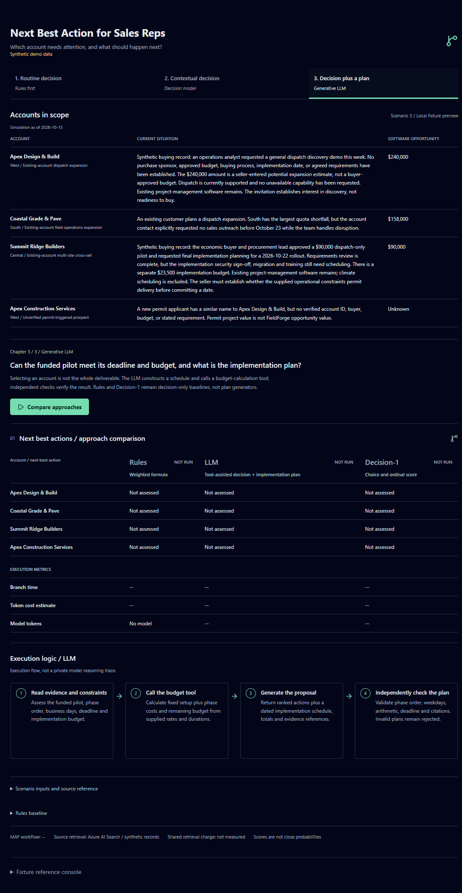

# Decision Lead Agent Demo

An independent starting point based on [microsoftiq-lead-agent-demo](https://github.com/olivierb123/microsoftiq-lead-agent-demo). The inherited application and architecture are preserved below while the decision-specific workflow is developed.

The demo uses Microsoft Agent Framework workflows to compare deterministic rules, a general-purpose LLM, and Microsoft-Decision-1 on daily seller attention allocation. The primary page defaults to retrieving exact synthetic scenario records from an isolated Azure AI Search index through the local MAF backend. The separate live IQ mode calls the existing Fabric IQ, Web IQ, and Foundry IQ agents. Live retrieval has been exercised, and real GPT-4o and Decision-1 inference calls have passed validation against the explicit synthetic fixture. Decision-1 was [approved and deployed](./docs/decision-model-plan.md#decision-1-deployment-approval) on October 15, 2026, with one DataZoneStandard unit. No predictions are simulated, and no quality or cost advantage has been established. The inherited stage descriptions below are historical, not separate screens in the current UI.

## Workflow At A Glance

The next-best-action question drives the choice of mechanism: use rules for explicit conditions, evaluate a bounded decision model for contextual choices, and use generation with tools when the output needs a plan. Shared policy and output validation surround every approach.



All three branches receive isolated copies of the same prepared evidence. Contact pauses, unverified identities, and missing or stale evidence are policy decisions, not constraints a model can override. See the [story-first blog draft](./docs/blog-rules-decision-models-llms.md) for the next-best-action use case and exact implementation excerpts.

## Workbench Screenshots

Captured from the local workbench on October 19, 2026, before running inference. These are explicitly labeled local synthetic fixture previews, not live CRM records or completed model results. The simulation date remains October 15, 2026; screenshot capture does not refresh the evidence. No hosted inference was invoked to capture these images.

### Routine Decision

Start with explicit buyer interest, current product fit, and shared contact restrictions. The workbench shows the account context, comparison table, and deterministic execution flow before **Compare approaches** is pressed.



### Contextual Decision

Contrast an exploratory discovery invitation with a funded, ready pilot. The Decision-1 flow shows the bounded action space; no picked action or score is attributed to the model before inference.



### Decision Plus A Plan

Add rollout constraints and a generated-plan requirement. The LLM execution flow distinguishes the calculation tool and independent checks from model generation; a plan appears only after a successful comparison.



## Local project setup

Open `decision-lead-agent-demo.code-workspace` in VS Code. In WSL, run `npm ci` followed by `npm run dev` to start the frontend.

Local environment files, installed dependencies, build output, and the original Git history are intentionally excluded. Use the root and `agent/` `.env.example` files as configuration templates when enabling services. Isolated demo Search indexes and the dedicated product-doc agent described below use existing Azure services; inherited deployment configuration still needs review before deployment.

### Decision workflow

Run these commands in WSL from this project root. The workflow has separate dependencies so the inherited hosted agents need not be installed or reconfigured:

```bash
uv venv --python 3.13 .venv
uv pip install --python .venv/bin/python -r agent/requirements-workflow.txt
npm ci
npm run workflow
```

In a second WSL terminal, run `npm run dev`. If port 5175 is occupied, use `npm run dev -- --port 5176`. The workflow listens on loopback port 8008; Vite proxies `/api/decision-workflow` to it. The proxy is development-only; `vite preview` and static hosting do not provide this API.

The workbench defaults to **Retrieved synthetic records**. Configure `DECISION_RECORDS_SEARCH_ENDPOINT` and `DECISION_RECORDS_SEARCH_INDEX=decision-demo-snapshots-v1` in the root environment file, then restart the workflow backend. The existing `srch-wkedqxabla6qo` service contains all eight variants, verified 1:1 against `buildComparisonSnapshot` in [src/data/decisionScenarios.js](./src/data/decisionScenarios.js). Each stored JSON record contains the complete four-candidate snapshot, including all evidence, values, IDs, dates, and explicit synthetic classification. Retrieval uses developer credentials for the Search audience, checks both the stored checksum and canonical fixture checksum, and fails closed on missing, corrupt, or changed records. The fixed `2026-10-15T12:00:00Z` simulation clock is not restamped. Actual retrieval time and index/record/checksum provenance appear separately in the Search retrieval receipt, never in model input. These records are authored simulations, not live Fabric/Web/Foundry responses; the fixture source names identify their authored domains.

Preview or republish these exact records from the canonical module, without hand-maintaining a second dataset:

```bash
.venv/bin/python scripts/seed_decision_snapshots.py
.venv/bin/python scripts/seed_decision_snapshots.py --upload
```

The first command is credential-free and performs no Azure writes. The second requires existing Search index/document-write permissions, targets only `decision-demo-snapshots-v1`, refuses to overwrite differing versioned records, and reads back all eight variants for exact equality. Backend retrieval needs only document-read permission. No shared hosted agents or shared indexes are changed by this path.

Select **Local synthetic fixture** to run those same records without Search, or change Summit's requirements, Coastal's meeting request, or stale/failed-source variants in either synthetic mode. Select **Live IQ sources** for the separate hosted-agent path: configure all three source endpoints, restart the backend, enter a seller question, and run. That mode retrieves existing demo datasets, not a live CRM integration. Fabric supplies historical territory totals rather than the fixture's account opportunities or buyer intent, so it is not a 1:1 fixture reconstruction. Live candidates support research only; unknown dates, missing provenance, stale sources, and failures require review. Fiscal labels and incomplete coverage remain visible. No fixture data is substituted on retrieval failure.

The collapsed fixture reference console is a separate inherited query path; its answers are not decision-workflow input. Compare mode runs every configured decision method, while selected mode runs one. Live IQ mode always retrieves all three agents and can incur their charges. Retrieved synthetic mode incurs Search retrieval and any selected hosted inference costs, but makes no IQ-agent calls. Stopping the browser wait does not cancel charges for requests already sent.

The MAF graph joins source evidence, validates it, applies shared policies, fans out to the selected decision branches, validates recommendations, and collects results. Live mode reads each deployed IQ source once; retrieved synthetic mode fetches one complete stored snapshot; local fixture mode reads the versioned module. All decision branches receive isolated copies of one prepared snapshot and report its fingerprint. Both synthetic paths produce identical prepared snapshots and policy outcomes without changing policy. The UI displays the returned snapshot and any agent-reported citations, which are not independent proof of factual support. If every candidate is policy-gated, the hosted adapters skip inference explicitly.

The workbench places the three IQ input panels and shared policy checks on the left, with decision outputs on the right (stacked on mobile). Source panels show requested/returned/empty/failed states and their returned content; the current API returns all source results together with the completed workflow, not as individually streamed completion events. The comparison table separates application-supplied defer/review outcomes from actual method decisions, and shows ranks, actions, and priority scores. Branch panels distinguish skipped inference from completed calls and report branch time, model token counts, and cost estimates when known.

Matching recommendations are a valid result, not a requirement to manufacture disagreement. The simple fixture can produce the same order/actions with different rubric scores; agreement does not establish equal quality, and scores are not calibrated probabilities. The former "No eligible opportunities selected" message did not mean there are no sales opportunities. The UI now distinguishes no source candidates, candidates blocked by shared policy, and a method choosing review instead of ranking. Missing source evidence must be repaired before a meaningful live model comparison; changing the layout does not bypass those policies.

### Three-Part Educational Demo

In scenario 2, the Decision-1 execution diagram displays per-account bounded choices beneath its horizontal flow. It displays the exact policy-allowed actions, highlights the returned choice, and shows its returned 0-3 priority score and rank where ranked. The score criteria are shown as a separate scale, not probabilities or per-action scores. Policy-excluded accounts are explicitly marked as not sent to Decision-1. Pending, unavailable or invalid output never receives a picked highlight.

Three scenario tabs sit below the title and synthetic-data disclosure. Selecting a tab changes the account context and approach explanation without sending inference requests. The **Compare approaches** button below the explanation explicitly runs all three methods against retrieved synthetic records. Completed results are retained per tab in browser memory; pressing compare again clears that tab's prior result before rerunning. The separate mode/scenario/execution toolbar is hidden for this focused demo. Other fixtures and modes remain supported by the backend API. Teaching targets and notes stay outside model input. Every run uses actual model responses and one shared prepared snapshot.

The primary view is titled **Next Best Action for Sales Reps**. Each tab shows the four accounts in scope, software opportunity values and current buying situations from its scenario evidence. Account context is explicitly labeled as a local fixture preview until a retrieved result arrives; it is not a fresh CRM query. The comparison combines method status and account-level next best actions in one table, with branch time, estimated token cost and input/output token counts in footer rows. Unassessed accounts remain marked as such before a run, and missing metrics are not reported as zero. A bold column outline marks observed qualifying approaches: chapters 1 and 2 highlight methods not beaten on both measured time and token cost after their case criterion is supported; chapter 3 requires the LLM's independently valid, feasible plan. Ties or cost/time trade-offs can outline multiple columns. Incomplete, mismatched or unsupported comparisons have no winner outline. This is not a general quality benchmark.

Below the table, a horizontal execution flow explains **Rules** for chapter 1, **Decision-1** for chapter 2, or **LLM** for chapter 3; it is not a private model reasoning trace. The duplicate detailed-recommendation/evidence-reference section is removed. The generated implementation plan and independent checks remain beneath the LLM flow. Inputs, sales reference, provenance and the prepared state remain under **Scenario inputs and source reference**, collapsed by default.

Recommended table actions open synthetic workspaces: **Contact now** includes a fictional reserved phone number, example.com email, subject and editable message; **Qualify opportunity** opens a CRM opportunity mock-up with stage, checklist and qualification request; **Human review** opens an IM draft to an account specialist. Saved drafts persist in browser memory for that scenario/account/action/method until reload. No phone call, email, IM, qualification request or CRM mutation is sent to an external system. Policy-deferred accounts have no contact command, and failed or pending model results have no actionable model suggestion. The pop-ups support Escape, close controls and native modal focus containment.

The input overview shows baseline facts or **Before / Now** changes against the preceding chapter, and distinguishes changed evidence from an expanded output task. Changed source records are highlighted and listed first; unchanged sources are labeled. Before a response arrives, source panels show an explicitly labeled local fixture preview. Preview data is never substituted into a failed retrieval or inference request. Retrieved results replace the preview only after the workflow returns. Scenario buttons are disabled while a comparison runs, with a stop-waiting control and visible errors on failure.

**Source boundaries:** this focused mode retrieves snapshots from Azure AI Search, not live Fabric, Web or Foundry IQ agents. Authored buying narratives are labeled **Synthetic opportunity records**, separate from **Synthetic external context**, **Synthetic product documentation**, and **Scenario assumptions**. Legacy `source` tags inside versioned payloads remain unchanged for fixture compatibility; they are not evidence of live IQ queries.

The **Sales performance** section shows the five original local `sales_performance` reference records beside the territory revenue/quota values actually embedded in the shared scenario. Original fiscal year, quarter and month labels are preserved without inferring calendar bounds or an effective timestamp. The reference spans mixed months and is not a single comparable reporting window. It is reference-only, not extra model input or a refreshed Fabric result. Snapshot territory/value pairs are deduplicated for display, never summed across accounts. The scenario's simulated reporting dates do not redate the original rows, and matching values do not establish a verified source join. Revenue/quota context cannot establish account identity, buyer intent or approved purchase budget.

1. **Routine decision** (`base`): explicit fit, buyer interest and shared policy make Apex the authored leading choice. When methods agree on ranks and actions, rules are the simplest adequate implementation, need no model tokens, and can be compared on actual branch time. This is decision agreement, not identical numeric scoring: raw scores remain visible and are not calibrated across methods.
2. **Contextual decision** (`discovery-vs-readiness`): the larger Apex estimate is exploratory; Summit has a funded, ready pilot. The case criterion is to put Summit first. If Decision-1 and the LLM meet that criterion while rules do not, the takeaway compares the two qualifying methods' measured time and token estimate. It never asserts Decision-1 is faster if the run says otherwise. Matching the leading choice does not imply every action/score agrees or establish equal quality generally.
3. **Decision plus a plan** (`reasoned-rollout`): the funded pilot also needs a schedule and implementation-budget calculation. All methods receive the same operational facts. Only the generative adapter additionally returns a structured plan; the other adapters are honestly labeled decision-only. The LLM calls a bounded `implementation_budget` tool that calculates phase costs, actual expenditure and remaining budget from those same facts, then generates the schedule and final proposal. Reported time and token cost include both model requests, including cached inputs. Independent checks validate account/policy eligibility, phase order, non-overlap, inclusive Monday-Friday durations, total cost, remaining budget, deadline assessment, and source references. The earliest feasible schedule is security October 16-19, migration October 20-21, and training October 22; total $23,200 leaves $300. This is a generated proposal, not a commitment. The LLM's extra work makes its time/cost a different workload, not proof of superior ranking or a like-for-like latency benchmark. A purpose-built scheduler could also solve these fixed constraints.

Two initial hosted planning checks produced correct schedules but incorrect costs; both were visibly rejected. This motivated the explicit arithmetic tool, not relaxed validation or replacement of model output with a prewritten answer. Tool use does not guarantee a valid plan: the returned schedule, totals and citations still have to pass checks.

Takeaways distinguish demonstrated contrasts from disagreement, missing models, unmatched snapshots, and invalid/infeasible plans. These are deliberately authored teaching cases, not a held-out accuracy study. Do not tune prompts or conceal results to manufacture the intended narrative. The seven pre-existing snapshots remain unchanged; the eighth adds explicitly synthetic planning assumptions without altering source dates, current product capabilities, contact pauses or entity checks.

Hosted browser checks on October 16, 2026, using retrieved synthetic records:

| Chapter | Observed Result | Branch Time / Estimated Token Cost |
| --- | --- | --- |
| Routine decision, 06:06 UTC | All three agreed on ranks and actions. | Rules: 0.13 ms / $0; LLM: 3,364.12 ms / $0.003690; Decision-1: 2,570.10 ms / $0.000110418. |
| Contextual decision, 06:07 UTC | Both models put Summit first; rules put Apex first. Apex's action still differed between models. | LLM: 6,509.38 ms / $0.003795; Decision-1: 3,619.02 ms / $0.000115248. |
| Decision plus a plan, 06:04 UTC | Tool-assisted LLM plan passed all checks: October 22 finish, $23,200 total, $300 remaining. | LLM: 7,386.28 ms / $0.016510, including both requests; the other branches supplied no plan. |

Each comparison confirmed identical prepared snapshot hashes across its three branches. These are single-run observations, not latency distributions or general quality claims. Token estimates exclude retrieval and hosting; chapter 3 performs additional work. All 66 tests, lint, build, and desktop/mobile overflow checks passed.

Two additional synthetic tradeoff scenarios exercise evidence the fixed formula does not model:

- **Tradeoff: deadline vs deal size** (`deadline-vs-value`): Apex has a smaller approved purchase with a next-day procurement deadline; Summit has a larger uncommitted estimate and an exploratory meeting in May 2027. The numeric fields and buying-signal booleans are identical to `summit-fit`, so the formula gives exactly the same result despite the different timing evidence.
- **Tradeoff: discovery vs funded pilot** (`discovery-vs-readiness`): Apex has a larger seller-entered estimate and a discovery invitation but no established buying process or approved budget; Summit has a smaller funded pilot with completed requirements review and a near-term rollout. Both requested a meeting and need only supported capabilities, so the formula does not distinguish discovery from purchase readiness.

Both retain the fixed simulation clock, product capabilities, Coastal contact pause, and unverified-company restriction. The original five stored record checksums are pinned by regression tests. All methods receive the same evidence and the same unchanged rubric; no expected output or method-specific instruction is included in the snapshots.

In the actual retrieved deadline comparison at `2026-10-16T05:29:42Z`, rules ranked Summit first (2.256, outreach) and Apex second (1.7976, outreach). GPT-4o ranked Apex first (3, outreach) and Summit second (1, research). Decision-1 also ranked Apex first (approximately 2.996, outreach), but chose outreach for Summit at approximately 1.108. All three validated successfully against shared snapshot `7efb433bba168c03d337fac9b164f8ec2c769d1160b73978887c27d10dc74589`. This is an observed demonstration, not a guaranteed future split or evidence of a quality advantage. Do not retune the evidence or prompts merely to force three different answers; measure actual ranks, actions, scores, latency, and usage.

The retrieved discovery/readiness comparison at `2026-10-16T05:31:21Z` also produced a three-way contrast: rules ranked Apex first (2.388, outreach) over Summit (1.824, outreach); GPT-4o ranked Summit first (3, outreach), but still chose outreach for Apex (2); Decision-1 ranked Summit first (approximately 2.999, outreach) and chose research for Apex (approximately 1.807). All three validated against shared snapshot `475aab28ab7339b62a1f7bdc4955ba17c26899edcc0d6a6ac4b48c9b7294cdce`, with real token usage reported for both hosted methods. These deliberately authored contrast cases are not an unbiased benchmark, and future runs may agree or differ.

Configure an existing Foundry resource origin and deployment name using `LLM_ENDPOINT` / `LLM_DEPLOYMENT` and `DECISION1_ENDPOINT` / `DECISION1_DEPLOYMENT` in the root environment file. Model endpoints must be HTTPS resource origins, not project or Responses URLs. Both model adapters use server-side `DefaultAzureCredential` with the Cognitive Services audience; live IQ retrieval uses the Foundry audience. No browser bearer token or API key is passed through. Local credentials need permission to invoke the existing services. The hosted Fabric tool uses its own service-principal identity, not the browser user's OBO identity. The LLM deployment must support Chat Completions structured JSON output. Both model adapters have passed real fixture inference checks. The approved `decision-1` deployment allows one request per minute; repeated runs can be throttled. Its preview version lists inference deprecation on February 4, 2027. Restart the backend after configuration changes.

Token estimates use reported usage and explicit USD rates per million tokens. The local configuration and root example use the following retail rates for the existing `eastus2` deployments:

| Deployment | Input | Cached input | Output |
| --- | ---: | ---: | ---: |
| GPT-4o `2024-11-20`, Global Standard | $2.50 | $1.25 | $10.00 |
| Microsoft-Decision-1 `1`, Data Zone Standard | $0.042 | Not configured | Free |

Source: the [Azure Retail Prices API](https://prices.azure.com/api/retail/prices), USD Consumption meters. GPT-4o's `gpt 4o 1120` global input/cached-input/output meters are priced per **1K** tokens, effective December 1, 2024; their rates above are converted to **1M** tokens. Decision-1's `eastus2` meter `7c75b204-ba69-5df4-bea2-66882a0d2292` is already per **1M**, effective October 1, 2026. Microsoft's [Decision-1 pricing announcement](https://commandline.microsoft.com/microsoft-decision-1-model-foundry/#pricing) confirms input-only billing and free output. Recheck rates for a different model, version, deployment tier, region, or billing agreement; restart the backend after changing them.

Cached input is a subset of total input: the calculator subtracts it before applying the ordinary input rate, then adds cached input and output at their respective rates. `LLM_CACHED_INPUT_USD_PER_MILLION` supplies the cache rate. Missing or invalid required rates/usage still produce `Unknown`, never an invented zero. Expand **Reported token usage** to inspect the actual counts. These are per-branch inference estimates, not billing records; they exclude Search, IQ retrieval, hosting, taxes, and agreement-specific discounts. Free Decision-1 output is not a claim that its entire workflow is free.

Decision-1 references identify supplied evidence, not a generated rationale or proof of entailment. Rule scores and model rubric scores are not calibrated sales probabilities. The current simple cases and structured signals may favor rules; they are not a benchmark proving Decision-1 is better.

```bash
npm test
npm run test:workflow
npm run lint
npm run build
```

The local API accepts fixed fixture IDs, bounded seller questions, and explicit execution/evidence modes. It rejects cross-origin requests and limits execution to one comparison at a time. This is not production authentication or authorization: live calls use the local developer identity regardless of the simulated UI persona or browser sign-in. Do not expose it publicly. Production deployment and any outreach require a separate verified access/approval boundary; this workflow sends no outreach and performs no CRM writes.

For Windows VS Code, select **Debug Decision Workflow (WSL)** and press F5. The provided task starts an alternate debug backend on port 8009; set `DECISION_WORKFLOW_URL=http://127.0.0.1:8009` and restart Vite to use it. Its WSL paths match this workspace; adjust them if relocated. This custom JSON service is not a Foundry Inspector/Responses host. See the [implementation plan](./docs/decision-model-plan.md) for the architecture and evaluation gates.

## Prepare product-document timestamps

The `decisionDemoDocs` export in [src/data/raw/productDocs.js](./src/data/raw/productDocs.js) contains four isolated synthetic product-document records. The original `docs` export is unchanged. Each new record has a `DECISION-DEMO-V1-` ID, original document/date provenance, `isSynthetic: true`, and a timezone-aware `effectiveAt`. For example, the DOC-1 fixture uses `2026-08-01T00:00:00Z`, preserving its original August 1 calendar date rather than making it appear newly updated.

The UTC midnight values are explicitly authored simulation values, not recovered publication times. `timestampProvenance` discloses that the original time and timezone are unknown. The searchable `content` includes these labels, IDs, dates, and timestamp metadata, and the native Search context provider preserves them for the model. Product summaries and the supported-capability/roadmap distinction are preserved.

Inspect the local records without credentials or Azure writes:

```bash
node --input-type=module -e "import { decisionDemoDocs } from './src/data/raw/productDocs.js'; console.log(JSON.stringify(decisionDemoDocs, null, 2))"
```

With approval, all four records were uploaded to the separate `decision-demo-product-docs-v1` index on `srch-wkedqxabla6qo`. It uses `decision-demo-product-docs-semantic-config`. Dedicated hosted agent `decision-foundryiq-docs-agent` version 1 was deployed to the existing `agent-dev` project on October 16, 2026 UTC, reusing `gpt-4o`. Its instance principal has Search Index Data Reader on this index only, with no document-write permission. The shared agents were not redeployed, and the original `product-docs` content fingerprint is unchanged.

The dedicated service uses JSON-only output and requires an in-text synthetic disclosure, each cited document's original date and fixture timestamp, and the oldest fixture timestamp among its citations. These settings apply only when its configured index is `decision-demo-product-docs-v1`; shared-index defaults remain unchanged. The local adapter also clarifies fixture-versus-publication timestamp semantics only for this dedicated endpoint. The evaluation suite is explicitly deferred.

Local, hosted CLI, and actual non-streaming app-transport smoke checks passed with exact IDs, an August 1 oldest fixture timestamp, and in-text synthetic disclosure. The app is wired to the dedicated endpoint and its backend was restarted. However, the final browser comparison at `2026-10-16T05:00:48Z` still failed: Foundry response `caresp_0c35384381289ed100NvpHElWqKWfbVNacjUzJVNMtSwon29Lb` listed all three fixture timestamps and UTC in text but inconsistently returned `effectiveAt: null`. Fabric and Web passed that run; all three territory candidates were blocked by `MISSING_EFFECTIVE_DATE`, and neither hosted decision model was called. A successful smoke response is not evidence of reliable end-to-end behavior. That live-agent limitation remains unresolved. The new retrieved-synthetic path above avoids model-mediated metadata reconstruction by fetching the exact canonical account fixture directly; it does not repair or relabel the live territory path.

The decision app's `FOUNDRY_IQ_AGENT_URL` and the example environment file use the dedicated agent's Responses endpoint. Restart the workflow backend after changing this setting. The existing search seed script still publishes the original dataset, not this export; do not run it to publish this variant. Freshness and provenance policy checks are unchanged, and simulated dates must never be presented as verified real publication dates or silently restamped when they age out.

## Prepare Fabric decision-demo data

Use the [Fabric seed guide](./docs/fabric-decision-demo.md) to run a credential-free Python script in a Fabric notebook. It writes separate, explicitly synthetic CSVs with comparable reporting dates, source lineage, and six opportunity scenarios. Existing files and cloud resources are not modified. The current Fabric semantic model is CSV Import mode, so connecting the generated data to a separate model/Data agent is an additional manual step; the current live adapter still consumes territory totals only.

## Inherited demo: Mapping Data to Microsoft IQ

A companion demo to [lead-agent-demo](https://github.com/olivierb123/lead-agent-demo), this time focused on **data grounding**: how an agent's answers get tied to real, trustworthy data sources rather than what the model already "knows."

Same build philosophy as the original — start cheap, prove it works, then operationalize — applied here to the question of *which grounding source an agent should use for which kind of data*.

---

## The problem this demo illustrates

Every agent needs to be grounded in data outside the model's own training. Microsoft offers several purpose-built grounding services under an "IQ" naming family, each suited to a different data domain:

| Data domain | Grounding source | Why |
|---|---|---|
| Internal structured business data (sales, inventory, finance) | **Fabric IQ** | Semantic/business-model layer over OneLake — understands your business model, not just raw tables |
| Native Microsoft 365 content (emails, docs, Teams, calendar) | **Work IQ** | Grounds directly in Microsoft Graph data the org already has |
| Public / real-world data (permits, filings, registries, news) | **Web IQ** | Citation-ready web retrieval built for LLM/agent consumption, not a search results page |
| Anything else custom / not native to the above | **Foundry IQ** | General-purpose agent knowledge/grounding layer |

Picking the wrong one — or reaching for a generic web scrape when a purpose-built IQ product already solves it — is the kind of mistake that's cheap to avoid early and expensive to unwind later. This demo walks through mapping one real data domain (municipal building permits, reused from the original lead-agent-demo) to the right IQ product, and building it up in stages.

---

## The three stages — bottom-up

Grounding is fundamentally a data-architecture problem before it's a UI problem, so this demo builds bottom-up rather than starting from a clickable prototype:

1. **Data & system-of-record inventory** — catalog the real systems of record behind each data domain and which IQ product grounds each one, with rationale. A reviewable artifact, not code.
2. **Data normalization & agent access** — show what that raw source data looks like once it's normalized into a consistent, citable shape an agent can actually query.
3. **Data governance & guardrails** — access control, citation enforcement, and audit: the layer that makes multi-source grounding safe to operationalize.

---

## Stage 1 (built): data & system-of-record inventory

A markdown catalog — [`docs/data-inventory.md`](./docs/data-inventory.md) — mapping each of 8 data domains to its concrete system of record and the IQ product that should ground it, with the reasoning for each mapping, plus [`docs/data-relationships.md`](./docs/data-relationships.md) documenting how those domains actually join to each other. The "Stage 1: Raw Data" tab in the console renders each domain's raw, source-shaped mock data so the inventory can be validated visually, not just read as a table.

## Stage 2 (built): normalized, agent-grounded console

A static React console (Vite + Tailwind CSS v4, matching lead-agent-demo's toolchain) showing what the Stage 1 inventory looks like once normalized: all 8 domains reshaped into consistent, citable records an agent can query and answer from, plus 2 composite records that join across domains (e.g. renewal risk assembled from CRM + telemetry + support cases on `accountId`) to show why grounding across sources — not just within one — is where the real value is. A query input on the "Stage 2: Grounded Console" tab keyword-matches a typed question against the records to simulate what an agent's retrieval step would surface. No real API calls or retrieval yet; the dataset and matcher are hand-written in `src/data/mockRecords.js` and `src/lib/matchRecords.js`.

Run it locally:

```bash
npm install
npm run dev
```

## Stage 3 (built): data governance & guardrails

The layer that makes multi-source grounding safe to operationalize, documented in [`docs/data-governance.md`](./docs/data-governance.md):

- **Access control** — an interactive persona switcher (Sales Rep, Customer Success, Executive) in the console header. Each role is granted a subset of the 8 domains, and any record that draws on a domain outside the active persona's access is fully blocked on the "Stage 2: Grounded Console" tab — including the 2 composite records, which flip between blocked and visible depending on the persona.
- **Citation / confidence enforcement** — every record is flagged `Verified` or `Needs verification`, derived directly from the hard-vs-fuzzy join classification in `data-relationships.md`. Only the permit-to-CRM composite (a fuzzy name match) is flagged `Needs verification`.
- **Audit log** — the "Stage 3: Governance" tab records every query submitted on Stage 2 (press Enter), live, in-session: persona, question, and how many results were matched vs. blocked. No backend, so it resets on refresh — same "simulate honestly" approach as Stage 2's matcher.

## Stage 4/5/6/7 (in progress): real Azure grounding

The first three stages are entirely mock data and a hand-written matcher. Stages 4, 5, and 6 make three of the four IQ products real, and Stage 7 combines them, all documented in [`docs/azure-implementation.md`](./docs/azure-implementation.md):

- **Foundry IQ (built and deployed)** — a second, independent Foundry Hosted Agent, grounded on a real Azure AI Search index (`product-docs`, seeded from `src/data/raw/productDocs.js` via `scripts/seed_search_index.py`) through Agent Framework's native `AzureAISearchContextProvider`. A **"Live: Foundry IQ"** toggle on the "Stage 2: Grounded Console" tab routes Product-Docs-domain questions to this real agent — streamed answer, real citations — while every other domain keeps using the Stage 2 mock matcher.
- **Fabric IQ, Sales Performance domain (built and deployed)** — grounded on a real Power BI/Fabric semantic model built from `src/data/raw/salesPerformance.js`, consumed via a published Fabric Data agent. Foundry's native `fabric_dataagent_preview` tool turned out to have a server-side connection-resolution bug, so this agent's tool instead calls the Fabric Data agent's own MCP endpoint directly, authenticating as a dedicated service principal rather than the signed-in user. Same **"Live"** toggle pattern on the Sales Performance record; CRM, Telemetry, Support Cases, and the cross-domain composite record stay on the Stage 2 mock matcher.
- **Real sign-in (MSAL)** — the "Live" toggle authenticates a real Entra ID user in the browser (`@azure/msal-browser`) rather than running every request as whichever developer has an `az login` session open; `vite.config.js`'s dev proxy forwards that user's own token, falling back to the developer's session only when no one is signed in.
- **Web IQ, Climate/Disaster Risk domain (built and deployed)** — a fourth Foundry Hosted Agent, grounded on Microsoft's real **Web IQ** live web-grounding API (`webiq.microsoft.ai`), searched via a custom function tool scoped toward authoritative hazard sources (NOAA, FEMA, NWS). Same **"Live"** toggle pattern on the Climate/Disaster Risk record, with real per-query citations (source domain, title, last-updated date) parsed from the live search results; Permits stays on the Stage 2 mock matcher.
- **Cross-IQ synergy — fan-out + live synthesis (built)** — one typed question ("Where should we focus new lead generation — factoring in territory quota performance, regional storm risk, and our competitive edge against Procore?") fans out concurrently to all three live agents above, then a **fourth** Foundry Hosted Agent (`synergy-agent`, no tools) synthesizes their three real answers into one attributed takeaway — a genuine live model call, not hardcoded prose. Three sub-panels (one per source agent) plus a "Synthesized takeaway" panel render on the composite record once all three sources finish.
- **Work IQ, and the rest of Fabric IQ** — documented architecturally (what real service, what it would take to stand up) but not built in this pass.

Running it locally requires the agents to be deployed and a `.env` pointing at them (see `.env.example`), plus MSAL config (`VITE_MSAL_CLIENT_ID`/`VITE_MSAL_TENANT_ID`) for real sign-in; `npm run dev` then proxies live requests through a dev-only auth layer in `vite.config.js`.

## Status

Stage 1, Stage 2, and Stage 3 complete. Stage 4/5/6/7 in progress (Foundry IQ, Fabric IQ's Sales Performance domain, Web IQ's Climate/Disaster Risk domain, and the cross-IQ synergy fan-out/synthesis agent built and deployed, all gated behind real MSAL sign-in; the rest of Fabric IQ plus Work IQ documented only).

## License

MIT
