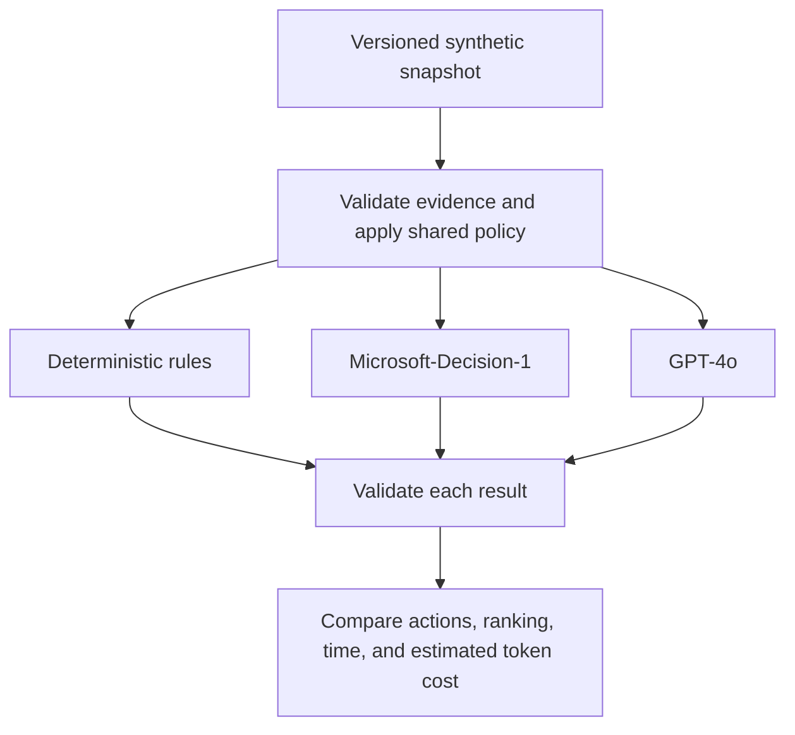

# What Should a Sales Rep Do Next? Rules, Decision Models, and LLMs in Practice

Imagine opening your account list at the start of the day. One customer wants a demo. Another has a larger potential deal, but its requirements may not match what your product can do. A third has asked you not to contact them for another week. A construction permit looks promising, but you are not even sure the applicant is the company in your CRM.

You do not need another summary of the list. You need to know: **what should I do next?**

That is the starting point for this demo: a *next best action* workbench for sales reps, built with Microsoft Foundry. It compares rules, GPT-4o, and Microsoft-Decision-1 against the same evidence. The accounts and evidence are synthetic; the hosted model responses are real.

The interesting part is not which model wins. It is how the sales question changes, and what that reveals about the kind of decision support we need.

## A Bigger Deal Is Not Always the Next Call

The first scenario puts four fictional sales motions in front of the rep:

- **Apex:** a $76,000 expansion. The buyer has requested a dispatch demo, and the capability exists today.
- **Summit:** a $210,000 cross-sell. The buyer wants capabilities that are not all established as currently supported.
- **Coastal:** a $158,000 expansion. The customer has explicitly paused sales contact until October 23.
- **A similar-name permit applicant:** a $3.1 million construction project, but an unverified account match and unknown software opportunity value.

Sorting by the largest number would miss the point. A construction budget is not software revenue. A large opportunity does not justify promising a roadmap feature. A territory's quota pressure does not override a customer's request not to be contacted.

So "next best action" is really two questions: **which account deserves attention, and what kind of attention is appropriate?** Contact now, clarify requirements, defer, and request human review are different outcomes. Doing nothing yet can be the correct one.

Some of those decisions should not be left to a model. In this application, code enforces contact restrictions, evidence requirements, and identity checks before any model recommendation is accepted. Coastal's pause is a boundary, not a factor a model can trade against deal size. The unverified applicant needs review, not a confident sales approach.

With those boundaries in place, we can compare how each method handles the remaining judgment.

## First, Try the Simple Answer

The first version uses a transparent scoring formula: software opportunity value, territory quota shortfall, a requested meeting, and whether the buyer needs an unavailable capability.

In the recorded routine comparison, all three methods agreed on the ranking and next actions. Rules needed no model tokens and were the simplest adequate implementation for that case.

That is a useful outcome. If the relevant facts are already explicit and a few conditions capture the decision, adding a model may add latency and cost without adding useful capability.

But consider what happens when "meeting requested" stops telling the whole story.

## The Same Meeting Request Can Mean Different Things

The second scenario is a separate authored version of the synthetic evidence, not a claim that these accounts changed in real time.

Apex now has the larger seller-entered estimate, but the meeting is exploratory: there is no established buying process or approved budget. Summit has a smaller funded pilot, completed requirements review, and near-term rollout readiness. Both have requested a meeting. Both need supported capabilities.

To the fixed formula, those meeting requests look the same. It ranks Apex first. To a rep reading the context, a discovery invitation and a funded pilot are not equivalent signals.

We could extend the rules with readiness fields and more conditions. That may be the right choice. But this is also where a different kind of model becomes interesting: one that interprets the evidence and returns a bounded decision rather than a paragraph.

### Where Decision Models Fit

Models such as [TypeSafe AI's Jev](https://typesafe.ai/blog/introducing-system-one-models-and-jev) have brought attention to this decision-first approach. Supply the situation, define the possible answers, and receive structured choices or scores that software can use directly. TypeSafe calls this a *System One* model.

[Microsoft-Decision-1](https://commandline.microsoft.com/microsoft-decision-1-model-foundry/) brings that approach to Microsoft Foundry. Instead of asking it to write a recommendation, this application asks two questions for each eligible account: **what action fits, and how much priority should it receive?** The application defines the available actions and the priority scale.

Decision-1 does not generate a written rationale. It returns a selected action and a score. Its API also supports yes/no probability questions. Jev is context for the emerging category, not a model tested in this comparison.

In the recorded contextual runs, both Decision-1 and GPT-4o ranked Summit first, while rules ranked Apex first. One earlier run also showed a useful distinction: GPT-4o suggested outreach for Apex; Decision-1 suggested researching it further.

The takeaway is not that models understand sales better than rules. It is narrower: **the context changed the models' recommendation in a way this particular formula could not express.** That is a reason to evaluate contextual judgment, not proof of better revenue outcomes. These are authored teaching cases, and "Summit first" is the intended case criterion, not a measured commercial result.

## Choosing the Account Is Only the Beginning

Now change the question again. It is no longer just "should we pursue the funded pilot?" It becomes:

> Can we propose a rollout that fits the customer's deadline and budget?

A selected action is no longer the complete answer. The rep needs a proposal: phases, dates, costs, and remaining budget.

That is the third scenario. All methods receive the same operational facts, but only the generative adapter is implemented to produce a plan. Rules and Decision-1 remain explicitly decision-only. GPT-4o uses a calculation tool for the budget, then returns a structured schedule and proposal.

The successful recorded plan finished on **October 22**, cost **$23,200**, and left **$300** of budget. Application code independently checked phase order, business-day durations, non-overlap, costs, deadline assessment, and supplied references.

The path to that result matters. Earlier model attempts produced correct schedules but incorrect costs, and the application rejected them. The fix was to provide an arithmetic tool, not weaken the checks or substitute a prewritten answer.

This is a role for generation alongside deterministic tools. It is not a claim that only an LLM can solve a schedule: a purpose-built scheduler could solve these fixed constraints too. It shows why **choosing an action and producing a usable plan are different tasks**.

## The Use Case Gives Us the Framework

We started with one sales question, but uncovered three kinds of work:

| What the rep needs | A mechanism to consider | What still belongs in code |
| --- | --- | --- |
| An action from explicit, structured facts | Rules | The conditions, formula, and permitted actions. |
| A contextual choice within known options | A bounded decision model, compared with a structured-output LLM | Evidence checks, action boundaries, and output validation. |
| A proposed plan or other generated artifact | A generative LLM with tools, or a purpose-built solver where appropriate | Calculations, constraint checks, and approval before action. |

This is why I find "rules, bounded decisions, and generation" more useful here than simply "deterministic versus non-deterministic." Repeatability alone does not tell us whether a recommendation is useful or correct. The required output and the cost of an error tell us more.

These mechanisms can coexist in one workflow. **Keep hard boundaries deterministic. Use contextual judgment where it adds value. Use generation when you need a generated artifact.**

Microsoft Agent Framework coordinates the comparison:



## What This Demo Does, and Does Not, Show

The comparison is deliberately small and inspectable. Every method receives the same prepared evidence; expected teaching outcomes stay out of model input. In the recorded decision-only runs, Decision-1 had lower measured branch time and estimated token cost than GPT-4o. Those are single-run observations, not a general speed, quality, or savings benchmark. The planning case performs additional work and is not a like-for-like latency comparison.

The scenarios use a fixed simulation time of **October 15, 2026, at 12:00 UTC**. The primary demo retrieves versioned synthetic snapshots from Azure AI Search, not live CRM or live IQ-agent responses. It does not turn historical records into fresh facts. The workbench opens editable synthetic drafts; it sends no outreach and makes no CRM changes.

"Best" therefore means a suggested next action under the supplied evidence and rubric, not a proven optimal action or a prediction of sales success. A valid response shape or evidence reference does not establish a correct judgment. Production use would need representative held-out evaluation, verified access controls, and appropriate human approval.

The practical starting point is simple: take a decision your users already make, define the available actions, identify the non-negotiable boundaries, and compare the simplest adequate implementation with the alternatives. Let the use case earn the complexity.

## Try the Workbench

The [decision-lead-agent-demo repository](https://github.com/olivierb123/decision-lead-agent-demo) contains the local workbench and the three scenarios. Follow the [local setup instructions](https://github.com/olivierb123/decision-lead-agent-demo/tree/d1a16a5#decision-workflow) to reproduce the comparison with approved model deployments and credentials. Hosted calls can incur charges.

Start with the routine case, where all three may agree. Then inspect what changes in the contextual case, and what extra work the planning task requires. The question to carry into your own application is not "where can I add AI?" It is **"what does the next action require that my current approach cannot provide?"**

## Technical Walkthrough: The Code Behind the Comparison

The story above does not require reading the implementation. For builders, the following sections retain the exact rules and invocation code, pinned to commit `d1a16a5`.

Microsoft Agent Framework runs each method against an isolated copy of the same prepared snapshot. Shared checks restrict actions before the decision and validate the result afterward. Invalid results are rejected rather than repaired and reported as successes. Snapshot fingerprints verify comparable inputs; evidence-reference checks verify membership, not the truth of a model's judgment.

### 1. The Rules Baseline

The baseline is intentionally transparent. It weights capped software opportunity value at 30%, proportional territory quota shortfall at 20%, a requested meeting at 30%, and no unavailable-capability requirement at 20%. It scales the result to 0-3.

Here is the complete rules runner from [the implementation at the demo commit](https://github.com/olivierb123/decision-lead-agent-demo/blob/d1a16a5/agent/decision_policy.py). The territory-specific branch supports the separate live research mode; the synthetic comparison uses the opportunity formula.

```python
async def rules_runner(snapshot: dict[str, Any]) -> dict[str, Any]:
    suggestions = []
    for candidate in snapshot["candidates"]:
        signals, policy = candidate["buyingSignals"], candidate["policy"]
        performance = candidate["territoryPerformance"]
        gap = max(0, performance["quota"] - performance["revenue"]) / performance["quota"]
        score = (
            30 * min((candidate["opportunityAmount"] or 0) / 250000, 1)
            + 20 * min(gap, 1)
            + 30 * (signals["meetingRequested"] is True)
            + 20 * (signals["requiresUnavailableCapability"] is False)
        )
        if snapshot.get("scope") == "territory-prospecting":
            score = 100 * min(gap, 1)
        action = "outreach" if signals["requiresUnavailableCapability"] is False and signals["meetingRequested"] is True else "research"
        if not {"outreach", "research"}.intersection(policy["allowedActions"]):
            action, score = ("defer" if "defer" in policy["allowedActions"] else "cannot_tell"), 0
        suggestions.append({
            "candidateId": candidate["candidateId"], "action": action, "priority": round(score * 3 / 100, 4),
            "evidenceIds": [item["evidenceId"] for item in candidate["evidence"]]
                           + [item["evidenceId"] for item in snapshot["productEvidence"]],
            "basis": (f"Territory research only: proportional quota shortfall {gap:.2f}; no inferred buyer intent."
                      if snapshot.get("scope") == "territory-prospecting" else
                      f"Rules: value {min((candidate['opportunityAmount'] or 0) / 250000, 1):.2f}; quota gap {gap:.2f}; meeting {signals['meetingRequested']}; unavailable capability {signals['requiresUnavailableCapability']}."),
        })
    return validate_recommendations({"status": "ok", "model": "Deterministic rules v1", "suggestions": suggestions,
                                     "usage": None, "inferenceCostUsd": 0}, snapshot)
```

These weights are demonstration heuristics, not validated sales economics. Their advantage is that their behavior is easy to inspect. Their limitation is equally concrete: the formula does not read whether a meeting is exploratory or follows an approved, funded pilot.

That limitation is not inherent to all rules systems. We could add structured readiness fields or more rules. The question is whether maintaining that logic is preferable to using a model for the contextual part.

### 2. Invoke Microsoft-Decision-1

Decision-1 is not a drop-in model-name change on the chat endpoint. It uses a different request contract:

```text
POST <resource-origin>/providers/microsoft/v1/systemone
```

The request contains the deployment name, shared state, and questions. The following is the complete adapter method from [the model adapters](https://github.com/olivierb123/decision-lead-agent-demo/blob/d1a16a5/agent/decision_models.py). Its surrounding class supplies the HTTP transport; `policy_exclusions`, `ACTIONS`, and `token_cost` are repository helpers.

```python
    async def decision1(self, snapshot):
        rubric = snapshot.get("rubric", RUBRIC)
        priority_criteria = (["No research priority or review required", "Low research priority", "Moderate research priority", "High research priority"]
                             if snapshot.get("scope") == "territory-prospecting" else
                             ["Not actionable or review required", "Exploratory", "Timely but uncertain", "Ready and timely"])
        questions, suggestions = {}, policy_exclusions(snapshot)
        for candidate in snapshot["candidates"]:
            candidate_id = candidate["candidateId"]
            allowed = candidate["policy"]["allowedActions"]
            if not {"outreach", "research"}.intersection(allowed):
                continue
            questions[f"action_{candidate_id}"] = {
                "type": "choice", "instructions": f"{rubric} Choose the next action for {candidate_id}.",
                "criteria": {action: ACTIONS[action] for action in allowed},
            }
            questions[f"priority_{candidate_id}"] = {
                "type": "score", "instructions": f"{rubric} Rate attention priority for {candidate_id}.",
                "criteria": priority_criteria,
            }
        if not questions:
            return {"status": "ok", "model": "No model call: all candidates policy-gated", "suggestions": suggestions,
                    "usage": None, "inferenceCostUsd": 0}
        response = await self.transport(
            os.environ["DECISION1_ENDPOINT"].rstrip("/") + "/providers/microsoft/v1/systemone",
            {"model": os.environ["DECISION1_DEPLOYMENT"], "state": snapshot, "questions": questions},
        )
        answers = response["answers"]
        for candidate in snapshot["candidates"]:
            candidate_id = candidate["candidateId"]
            if not {"outreach", "research"}.intersection(candidate["policy"]["allowedActions"]):
                continue
            action_answer, score_answer = answers[f"action_{candidate_id}"], answers[f"priority_{candidate_id}"]
            if action_answer.get("type") != "choice" or score_answer.get("type") != "score":
                raise ValueError("Unexpected Decision-1 answer type")
            suggestions.append({"candidateId": candidate_id, "action": action_answer["choice"], "priority": score_answer["score"],
                                "evidenceIds": supplied_ids(candidate, snapshot),
                                "basis": "Supplied evidence references; Decision-1 provides no written rationale."})
        return {"status": "ok", "suggestions": suggestions, "usage": response.get("usage"),
                "model": response.get("model", os.environ["DECISION1_DEPLOYMENT"]),
                "inferenceCostUsd": token_cost(response.get("usage"), "DECISION1")}
```

Two details matter. First, each question identifies the candidate in its instructions, not only in its dictionary key. Second, action criteria come from the application's policy-allowed set. Related action and priority questions share one request and one state.

The four score levels run from 0 to 3; a returned score can fall between levels. The demo consumes the selected action and score, not the full probability distributions. The evidence IDs attached here are **supplied references**, not model-generated citations or a written explanation.

### 3. Invoke GPT-4o With Structured Output

The LLM receives the same snapshot and qualitative rubric, but uses Chat Completions with a strict JSON schema. The basic comparison asks for decisions, not a persuasive paragraph. That gives the LLM a bounded task too, rather than making it generate an explanation that Decision-1 cannot provide.

These are exact excerpts from `HostedModels.llm`, not a standalone script. The method derives `eligible_ids` from policy and defines this schema:

```python
        item_schema = {
            "type": "object", "additionalProperties": False,
            "properties": {"candidateId": {"type": "string", "enum": eligible_ids}, "action": {"type": "string", "enum": ["outreach", "research", "cannot_tell"]},
                           "priority": {"type": "number"}, "evidenceIds": {"type": "array", "items": {"type": "string"}}},
            "required": ["candidateId", "action", "priority", "evidenceIds"],
        }
        schema = {"type": "object", "additionalProperties": False,
                  "properties": {"suggestions": {"type": "array", "items": item_schema}}, "required": ["suggestions"]}
```

For the decision-only task, `plan_instruction` is `"Do not generate an explanation."` The payload and endpoint are:

```python
        payload = {
            "model": os.environ["LLM_DEPLOYMENT"],
            "messages": [{"role": "system", "content": rubric + f" Return JSON suggestions ONLY for these eligible candidate IDs: {json.dumps(eligible_ids)}. The application supplies excluded candidates separately. Use candidateId, action, priority and evidenceIds. " + plan_instruction},
                         {"role": "user", "content": json.dumps(snapshot)}],
            "response_format": {"type": "json_schema", "json_schema": {"name": "seller_priorities", "strict": True, "schema": schema}},
        }
        endpoint = os.environ["LLM_ENDPOINT"].rstrip("/") + "/openai/v1/chat/completions"
```

After any optional planning-tool interaction, the actual call and parsing are:

```python
        response = await self.transport(endpoint, payload)
        responses.append(response)
        result = json.loads(response["choices"][0]["message"]["content"])
```

The schema constrains response structure. Shared application validation still checks policy, candidate coverage, score bounds, and evidence references. Structured output is not a substitute for those checks.

### 4. Run the Demo Locally

To try the story yourself, clone the [demo repository](https://github.com/olivierb123/decision-lead-agent-demo) and open it in WSL. You need Node.js/npm compatible with the project, Python 3.13, and `uv`. For the full comparison, you also need access to existing GPT-4o and Microsoft-Decision-1 deployments and an Azure AI Search index containing the synthetic snapshots. Starting the local app does not provision those services.

**Configure your environment.** Create a root `.env` using the repository's `.env.example` as a template. Set these values for your own resources:

| Setting | What to provide |
| --- | --- |
| `LLM_ENDPOINT` / `LLM_DEPLOYMENT` | Your GPT-4o resource origin and deployment name. |
| `DECISION1_ENDPOINT` / `DECISION1_DEPLOYMENT` | Your Decision-1 resource origin and deployment name. |
| `DECISION_RECORDS_SEARCH_ENDPOINT` | Your Azure AI Search service endpoint. |
| `DECISION_RECORDS_SEARCH_INDEX` | `decision-demo-snapshots-v1`, populated with the repository's canonical records. |

Model endpoints must be HTTPS resource origins, not project URLs or complete API paths. Sign in with a local Azure developer identity permitted to invoke both models and read the Search documents; the backend uses that identity, not the simulated UI persona. No credentials belong in the browser configuration.

Follow the [snapshot-seeding instructions](https://github.com/olivierb123/decision-lead-agent-demo/tree/d1a16a5#decision-workflow) to populate your own index before comparing. Setting its name alone does not create or load it. The seeding tool offers a credential-free preview; uploading requires approved access and index/document-write permissions. The focused three-tab UI retrieves these stored synthetic records and does not silently substitute local fixtures if retrieval fails. You do not need to deploy the separate IQ agents for this path.

**Start the comparison backend.** From the repository root in a WSL terminal:

```bash
uv venv --python 3.13 .venv
uv pip install --python .venv/bin/python -r agent/requirements-workflow.txt
npm ci
npm run workflow
```

The backend listens on `http://127.0.0.1:8008`. Restart it after changing environment settings.

**Start the workbench.** In a second WSL terminal, from the same repository root:

```bash
npm run dev
```

Open `http://localhost:5175/`. If that port is occupied, run `npm run dev -- --port 5176` instead and open `http://localhost:5176/`. Use the development server, not `vite preview`: the development server forwards comparison requests to the local backend.

**Walk through the three scenarios.** Select a scenario tab, inspect the account context, then press **Compare approaches**. Switching tabs does not itself call a model. Start with the routine case, move to the discovery-versus-readiness case, and finish with the rollout plan. Compare the returned actions and ranks, then inspect branch times, token estimates, and the plan's independent checks. If a branch is unavailable or fails, treat that as an incomplete comparison, not a model recommendation.

Hosted inference and Search can incur charges. The deployment used for the recorded demo permits one Decision-1 request per minute, so allow at least a minute between comparisons on that deployment; your own limits may differ. This is a local development app: keep the backend on loopback and do not expose it publicly.

### 5. Measurement Details

The repository records these hosted browser observations from October 16, 2026. Each comparison confirmed matching prepared snapshot fingerprints across branches.

| Scenario | Observed result | Branch time / estimated inference token cost |
| --- | --- | --- |
| Routine, 06:06 UTC | All methods agreed on ranks and actions. | Rules: 0.13 ms / $0; GPT-4o: 3,364.12 ms / $0.003690; Decision-1: 2,570.10 ms / $0.000110418. |
| Contextual, 06:07 UTC | Both models ranked Summit first; rules ranked Apex first. | GPT-4o: 6,509.38 ms / $0.003795; Decision-1: 3,619.02 ms / $0.000115248. |
| Decision plus plan, 06:04 UTC | Tool-assisted GPT-4o plan passed independent checks. Other adapters supplied no plan. | GPT-4o: 7,386.28 ms / $0.016510, including both requests. |

These are **single-run observations on deliberately authored synthetic cases**, not latency distributions, a held-out accuracy study, or a general savings claim. A future run can produce different timings or decisions. GPT-4o is the existing general-purpose baseline, not an exhaustive search for the best alternative model.

Costs use returned token usage and configured retail rates. Cached GPT-4o input is priced separately without double-counting. Estimates exclude Search, IQ retrieval, hosting, taxes, and contract-specific adjustments; $0 for rules means no inference token charge, not zero operating cost. Microsoft's [launch pricing](https://commandline.microsoft.com/microsoft-decision-1-model-foundry/#pricing) lists Decision-1 at $0.042 per million input tokens with free output. Recheck current pricing, deployment availability, and preview lifecycle before reproducing the experiment.

Before relying on model scores, evaluate representative held-out cases, paraphrases, and option ordering. Measure abstentions, invalid outputs, failures, latency distributions, and cost per successfully validated task. A priority score is not a probability of closing a sale, and matching actions or rankings does not imply calibrated score equivalence.

For model setup and the current API contract, see [Deploy and use Microsoft-Decision-1 in Microsoft Foundry](https://learn.microsoft.com/en-us/azure/foundry/foundry-models/how-to/use-foundry-models-microsoft-decision). The local service uses developer credentials and is not a production identity or authorization boundary; do not expose it publicly. The repository's separate live territory-research mode is not the account-level synthetic experiment described here.