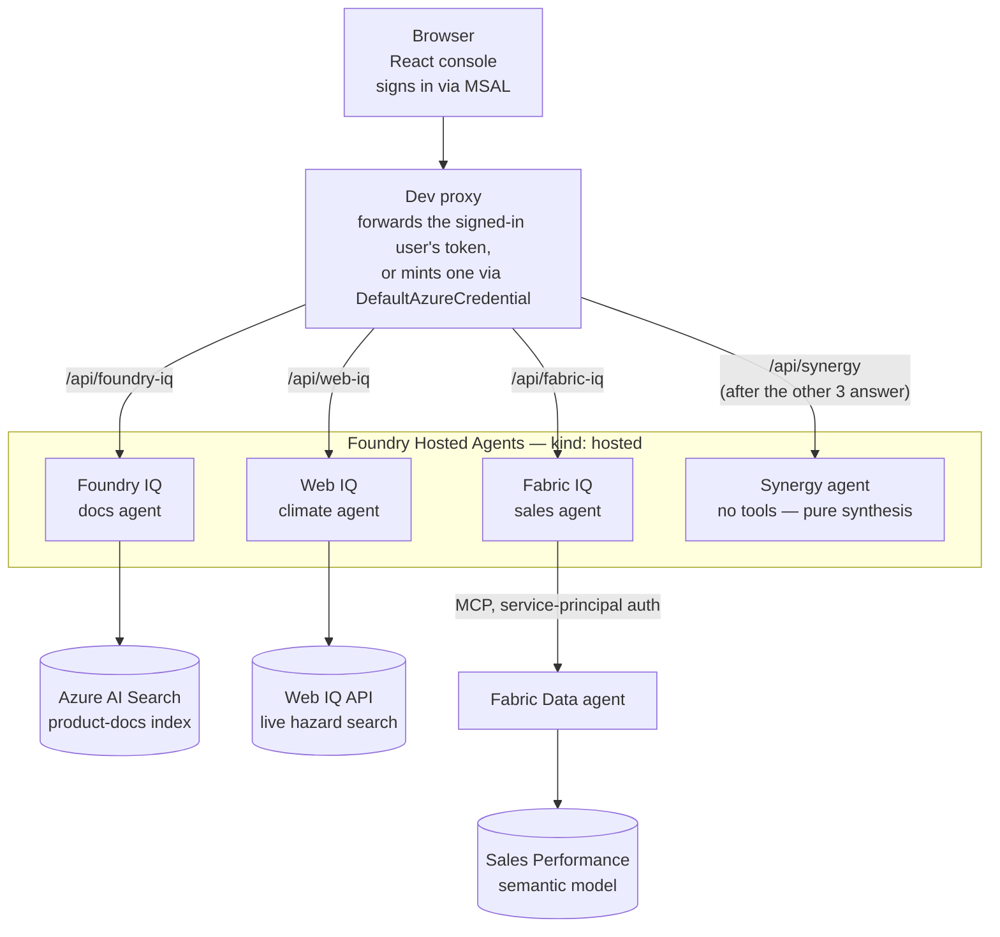

# Which IQs to Use? How About All of Them

**Olivier Bourgeot** · September 30, 2026

### Picking up where the last post left off

The [previous post](https://www.linkedin.com/pulse/from-business-brief-production-agent-building-three-stages-bourgeot-ajv9c/) walked through building FieldForge's sales-development agent in three stages, and closed with a deliberate gap: everything in it ran on synthetic permit feeds and mock company data. I said the data side was its own story. This is that story.

One note before going further: this entire project — the fictitious construction-tech company FieldForge, its rivalry with Procore — is a demo built for learning purposes, not a real deployment. The code, the architecture, and the four Foundry Hosted Agents behind it are real and genuinely running; the company and its data are not. I'm calling this out up front because the question this post is actually trying to answer doesn't depend on the company being real: **once you have a working agent, which of Microsoft's "IQ" grounding products should feed it data, and does combining more than one of them for a single question actually work, or just look good in a diagram?**

### A quick primer on the IQ family

Microsoft currently offers four distinct grounding products under the "IQ" name, and while they can sound interchangeable from a distance, each one is built for a different kind of data:

| Data shape | Product | What it grounds in |
|---|---|---|
| Structured business data — sales, quota, inventory | **Fabric IQ** | a semantic/business-model layer over OneLake, so an agent can query a business model without writing its own DAX or SQL |
| Native Microsoft 365 content — mail, calendar, Teams | **Work IQ** | directly in Microsoft Graph, so it's already inside an organization's collaboration data |
| Public, real-world data — permits, filings, hazard reports | **Web IQ** | live web retrieval built for agents, with citations attached so an answer can be checked |
| Documents and custom knowledge | **Foundry IQ** | whatever index you bring — the general-purpose option |

The practical risk isn't picking a "wrong" one outright — it's defaulting to the general-purpose option out of familiarity when a purpose-built one would serve a given domain better, and not discovering that until several services already depend on the choice. So before committing to a mapping, I wanted to test it the same way the agent itself was built last time: cheapest validation first, real infrastructure last.

### Stage 1: starting with a plain inventory of the data

Before writing any retrieval code, I put together a simple markdown table: eight data domains, each one's real-world system of record, which IQ product should ground it, and the reasoning behind that choice. A companion document captured how the domains relate to each other — for example, a lead record ties to a permit record through a fuzzy name match, while a support case ties to an account through a hard ID match. None of this touches a cloud resource yet, because none of it needs to at this point.

The goal of this stage was simply to make the domain-to-IQ mapping reviewable on paper before any engineering investment. If "Sales Performance should map to Fabric IQ" needed a long justification, that would have been a signal to slow down. Since it didn't, the next step was to confirm the mapping held up once real, structured data was behind it.

*Stage 1: the eight domains shown in their native, source-shaped form, before any normalization or matching logic is applied.*

### Stage 2: validating the mapping with synthetic data

This stage is where the mapping actually gets tested, still without any cost beyond development time. All eight domains were normalized into one consistent, citable record shape, and a typed question is run through a simple keyword-matching function rather than a real model. Two of the records are intentionally composite, joining data across domains — one combining CRM, telemetry, and support cases into a "renewal risk" record, another combining CRM and product documentation into an "upsell context" record — because the real test wasn't whether a single domain could be retrieved correctly. It was whether a question spanning multiple domains still produced a coherent answer once more than one IQ product would need to contribute to it.

One practical lesson from this stage: a keyword matcher is only as good as the vocabulary it has to work with. When the composite records were first written with naturally varied language, the matcher stopped reliably surfacing them for the intended demo question. Reusing consistent terms across the record's query, domain, and answer text — quota, territory, storm, risk, competitive — fixed it. It's a small detail, but it's a useful reminder that even a lightweight matching layer benefits from the same vocabulary discipline that real retrieval systems rely on.

*Stage 2: the same console interface, now backed by normalized, citable records and a working — if intentionally simple — matching layer.*

### Stage 3: governance before anything goes live

A pipeline that answers correctly for one user isn't automatically safe to open up to everyone. That's a distinct problem, and one that's often addressed late rather than designed in from the start. Stage 3 added the governance layer needed to make multi-source grounding operable, still well ahead of any real cloud deployment:

- **Persona-based access control** — an interactive switcher between Sales Rep, Customer Success, and Executive roles. Each persona has visibility into a different subset of the eight domains, and any record — including the composite ones — that touches a domain outside the active persona's access is visibly blocked rather than simply hidden.
- **Confidence flagging** — every record is marked `Verified` or `Needs verification`, based on whether the cross-domain join behind it used a hard key match or a fuzzy one. A permit-to-CRM match based on company name, for instance, is honestly flagged as needing verification rather than presented with unearned confidence.
- **An audit log** — every query, the persona that issued it, and what was matched or blocked, recorded as it happens.

None of this required a single real IQ product to be deployed. Access control and citation trust are properties of the data model and record design, not of which backend eventually answers a query — which means they can and should be validated before the more expensive integration work begins.

*Stage 3: the same console, now with persona-based access control, confidence flagging, and a live audit trail.*

### Stage 4: deploying the real thing, then combining it

Three of the four IQ products were deployed as real Foundry Hosted Agents, authenticated through Entra ID sign-in rather than a developer's local credentials. Foundry IQ grounds Product Docs through a real Azure AI Search index. Fabric IQ grounds Sales Performance through a published Fabric Data agent reached over MCP — this integration required a service principal rather than a managed identity, which took a couple of iterations to get right. Web IQ grounds Climate/Disaster Risk through the actual Web IQ API, scoped to NOAA, FEMA, and NWS sources. All three stream real, cited answers into the same UI component used since Stage 2 — the interface didn't need to change, only what was answering through it.

Having three working IQ integrations answered the first question, but it was really only half of what this demo was built to test. The more interesting question is the one in the title: not which single IQ to use, but what happens when a question doesn't fit neatly into one domain. Consider something like: "Where should we focus new lead generation, accounting for territory quota performance, regional storm risk, and our competitive position against Procore?" There is no single correct source for that question. Quota performance lives in Fabric IQ. Storm risk lives in Web IQ. Competitive positioning lives in Foundry IQ. Answering it well requires all three.

So a single typed question is fanned out to all three agents **concurrently**, not as three separate prompts, and once all three respond, a fourth Foundry Hosted Agent is invoked to synthesize the results. This fourth agent has no tools of its own — no search index, no semantic model, no external API. Its only input is the three other agents' real, already-cited answers, and its task is to combine them into one short, attributed takeaway. It would have been simpler to generate that final summary with a fixed template, but doing so would have undermined the actual point of this stage: proving that a model can meaningfully combine grounded answers from different sources, rather than assuming it can.

*Stage 4: three real agents answering the same question in parallel, with a fourth agent's synthesized takeaway appearing once all three have responded.*

### What each stage was actually for

Looked at together, the four stages follow a consistent principle: each one answers a specific question at the lowest possible cost before the next, more expensive stage begins.

- Stage 1 confirms the domain-to-IQ mapping is sound, for the cost of a markdown table.
- Stage 2 confirms that mapping holds up against a real cross-domain question, for the cost of development time.
- Stage 3 confirms the system is safe to extend to more than one type of user, before anything real is deployed.
- Stage 4 confirms that combining real sources produces a better answer than relying on any single one — the one question in this sequence that could only be answered with something actually running.

Work IQ and the remaining Fabric IQ domains are documented but not yet built, for the same reason the earlier stages were kept deliberately narrow: it's more useful to validate a pattern fully with one example before extending it to others. Taken together, the two posts answer two questions in the order they need to be answered — first, whether the agent itself is worth building, and only once that's established, whether the data grounding it can actually be trusted.
