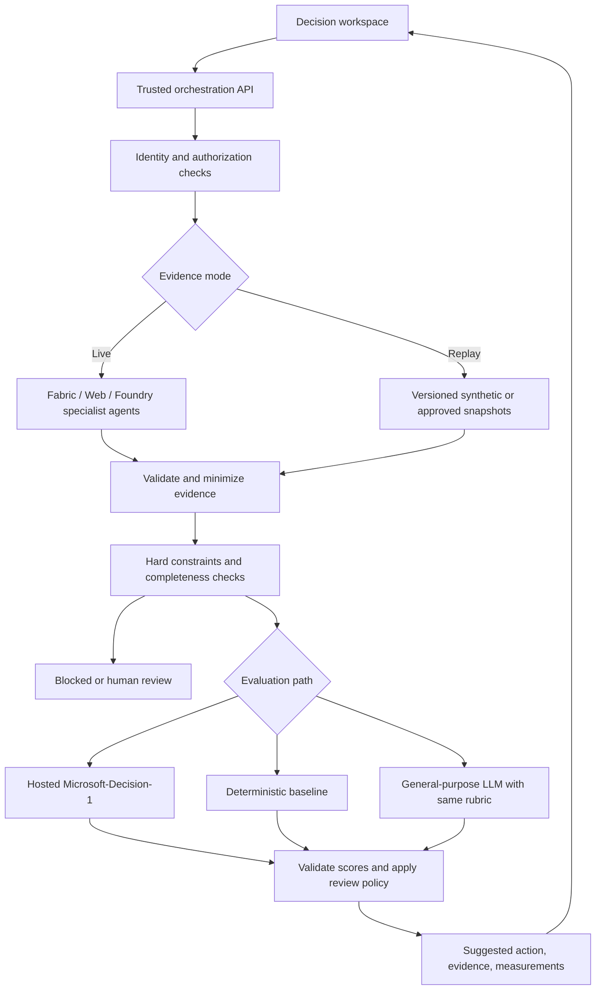

# Decision Lead Agent Demo: Review and Implementation Plan

Status (2026-10-15): local MAF workflow calls the existing hosted Fabric IQ, Web IQ, and Foundry IQ services. The browser defaults to live retrieval and shows the returned snapshot, source responses, provenance, and policy gates. GPT-4o has passed a real structured-output inference check on the explicitly synthetic fixture (2,216 input / 87 output tokens). After explicit approval, Decision-1 was deployed and passed a real fixture inference check (2,631 input / 4 output tokens). Both adapters honor the prepared snapshot's rubric. Production authorization, validated data freshness, and measured comparative quality/cost remain pending.

## Decision-1 Deployment Approval

**Approved and deployed on 2026-10-15.** Azure returned `Succeeded`. Existing IQ deployments and Fabric capacity were not changed; the approved operation added only one model deployment to the authorized existing account.

| Setting | Approved or observed value |
| --- | --- |
| Subscription | `b7fdcea6-b30a-43fc-b3a1-7f2e30b31e7e` |
| Resource group / account | `rg-agent-dev` / `cog-wkedqxabla6qo` |
| Region / project | `eastus2` / `agent-dev` |
| Deployment name | `decision-1` |
| Model | `Microsoft-Decision-1`, format `Microsoft`, version `1` |
| SKU | `DataZoneStandard`, US data zone; this is the SKU actually exposed by this account, not the catalog's generic GlobalStandard example |
| Deployed capacity | `1`, accepted by Azure. Deployment metadata reports one request per 60 seconds. Repeated inference calls can be throttled; no automatic capacity increase is configured by this application. |
| Quota observed | East US 2 `AIServices.DataZoneStandard.Microsoft-Decision-1`: 0 used of 60 requests/minute. This is subscription quota, not a deployment throughput guarantee. |
| Lifecycle | Preview; account metadata lists inference deprecation on **2027-02-04**. Recheck before deployment and plan replacement/removal before that date. |
| Pricing | Published launch price: $0.042 per million input tokens, output free. Verify current account/contract pricing before configuring cost estimates. Not a monthly cost quote. |

The approved scoped create operation completed successfully:

```bash
az cognitiveservices account deployment create \
    --subscription b7fdcea6-b30a-43fc-b3a1-7f2e30b31e7e \
    --resource-group rg-agent-dev --name cog-wkedqxabla6qo \
    --deployment-name decision-1 \
    --model-name Microsoft-Decision-1 --model-format Microsoft --model-version 1 \
    --sku-name DataZoneStandard --sku-capacity 1
```

Availability and quota were rechecked immediately before creation. This is an explicitly approved ad-hoc model deployment outside the inherited account's azd lifecycle; the existing agent manifest was not altered. Reconcile ownership in that manifest before any future full infrastructure redeploy. No `azd up` or IQ-agent redeployment was run. The ignored local `DECISION1_ENDPOINT` and `DECISION1_DEPLOYMENT` now point to this deployment. The real synthetic smoke test returned model `microsoft-decision-1`, selected Apex for outreach and Summit for research, and passed shared policy/output validation in about 2.5 seconds. Paused and unverified outcomes were supplied by the application, not attributed to model inference. This single run is not an accuracy, latency, or savings benchmark; token cost remains unknown without verified rates. Deleting only the new `decision-1` deployment is the rollback; never delete the account or existing deployments.

### Live Data Readiness

Fabric's verified live query returned FY26 Q1 totals: Central $803,000 / $760,000 quota (Jul and Sep), South $61,000 / $90,000 (Aug), and West $320,000 / $350,000 (Jul and Aug). All have incomplete month coverage. Exact effective dates were not returned; no fiscal-to-calendar mapping is invented. Foundry returned product document IDs without effective dates; Web returned dated context that is not verified territory-specific hazard evidence. These demo datasets cannot establish account buyer intent or current opportunity readiness.

The live scope is therefore territory research, never account outreach. Missing/ambiguous dates, missing provenance, stale evidence, and source failures trigger review, not substitute fixtures or invented facts. The live deterministic baseline is three times proportional quota shortfall only when shared policies allow research. The account-oriented fixture rubric remains separate. A live branch that skips inference because all candidates are gated is labelled as such; it is not a successful model prediction. Current source/model cost totals are unknown, not zero.

## Recommendation

Use a practical sales scenario to determine whether Decision-1 is worth using, not to make it win. Keep specialist agents as the eventual evidence collectors. Compare rules, a structured-output LLM, and Microsoft-Decision-1 given one evidence snapshot and rubric. Retain a simpler approach if evaluation does not justify the specialized model.

Do not simply change the model name in the Synergy agent. Decision-1 does not generate prose, summaries, or explanations. Keep the existing synthesis as a legacy comparison, not as the primary Decision-1 experience.

Local inference is out of scope following the project direction agreed on 2026-10-15. Focus the demo on seller attention allocation, bounded next actions, explicit review outcomes, and the quality/cost trade-off of replacing the final synthesis step.

## Implemented MAF Workflow

The runnable local implementation supersedes the earlier per-candidate-only emphasis below. Primary question: **Which up to three eligible opportunities deserve seller attention today, and what should happen next?** Never fill slots with ineligible candidates just to reach three.

```text
Live IQ request or fixed synthetic snapshot
    -> Fabric IQ / Web IQ / Foundry IQ readers (MAF fan-out)
    -> evidence join, validation, freshness and shared policies
    -> rules / LLM / Decision-1 (compare mode, or one selected branch)
    -> per-branch recommendation validation
    -> collected results, usage, latency, and shared snapshot fingerprints
```

- [decision_workflow.py](../agent/decision_workflow.py): real `WorkflowBuilder` executors, fan-out/fan-in, branch timeouts, isolated inputs, error states, and result collection; tested with `agent-framework-core==1.22.0`.
- [decision_policy.py](../agent/decision_policy.py): dated-source checks, entity verification, contact-pause constraints, transparent rules, and output validation. Violating recommendations are rejected rather than repaired and reported as successes.
- [decision_models.py](../agent/decision_models.py): separate Chat Completions structured-output and Decision `systemone` adapters. Decision-1 uses choice/action and ordinal priority questions in one request. Deterministic exclusions are not presented as model decisions. No credentials are sent to the browser.
- [decision_server.py](../agent/decision_server.py): loopback development API accepting bounded seller questions, fixed scenario IDs, and explicit modes. Live mode requires all three configured IQ endpoints; fixture mode loads the same module as the UI. It is not a production security boundary.
- [decision_sources.py](../agent/decision_sources.py): strict JSON envelopes from hosted IQ responses, source-response provenance, exact reporting labels, territory-only candidates, and no fixture fallback. Agent-reported citations are not independent verification.
- [DecisionWorkbench.jsx](../src/DecisionWorkbench.jsx): compare/selected modes, scenario changes, policy outcomes, source references, token usage, and unavailable/error states. No invented model output, confidence, quality, or savings indicators.

Scenario changes include Summit confirming dispatch-only requirements, Coastal requesting remote planning despite unchanged weather, stale Apex context, and a failed Web IQ source. Structured `buyingSignals` are authored synthetic evidence shared by all methods, not extracted or predicted by a model. They intentionally allow rules to succeed on simple cases. More ambiguous and independently reviewed held-out cases are still needed to establish Decision-1's value.

Shared hard policies apply to all methods. The deterministic priority baseline weights capped software value (30%), proportional quota gap (20%), requested meeting (30%), and no unavailable capability requirement (20%), scaled to 0-3. These are demonstration heuristics, not validated business economics. The LLM and Decision-1 use a shared qualitative rubric; equal numeric ranges do not establish calibrated score equivalence.

Compare mode can incur every configured branch's cost; selected mode runs one. Live mode still retrieves all three sources once before branching. Hosted token cost is estimated only from returned usage and explicitly configured rates, with cached input priced separately without double-counting. Missing or invalid required rates/usage remain unknown. See the [README pricing notes](../README.md#decision-workflow) for the current deployment rates, sources, units, and exclusions. No upstream savings or total retrieval/billing cost can be claimed. The remaining review and phases describe the original fixture experiment and production target, not completed production deployment work.

## Verified Model Facts

| Topic | Evidence and implication |
| --- | --- |
| Name | The official release is **Microsoft-Decision-1**, not MAI-Decision-1. Microsoft says a future rebase may use MAI or OpenAI models. |
| Base | Post-trained from Qwen3.5-9B. This does not mean Microsoft's post-trained weights are publicly downloadable. |
| Output | Typed decisions and probabilities, not generated text or a written rationale. |
| Inputs | Text or JSON state, plus explicitly defined questions and answer criteria. Text-only, with a 32,768-token context window. |
| Primitives | `noul`: probability of a yes/no condition; `choice`: a selected option and option probabilities; `score`: a probability-weighted position on an ordered rubric. |
| API | Foundry resource endpoint plus `/providers/microsoft/v1/systemone`. The request's `model` is the deployment name. This is not the existing Responses/SSE interface. |
| Authentication | The documented Entra scope is `https://cognitiveservices.azure.com/.default`, unlike the existing hosted-agent proxy's `https://ai.azure.com/.default`. Do not blindly forward the current browser token to this API. |
| Availability | Hosted access is documented through Foundry and OpenRouter. The official sources reviewed do not establish public weights, a self-host license, or a supported local runtime for this exact model. |
| Pricing | The launch advertises $0.042 per million input tokens and free output tokens. Verify the actual deployment's current price before displaying billed estimates. |
| Limitations | No explanations; sensitive to task framing and possibly option order; probabilities need validation on the target workload. A high score does not verify external facts or predict commercial success. |

The Foundry catalog labels the model Preview. Deployment availability, lifecycle, region, and pricing should be rechecked during implementation. Do not turn vendor benchmark speedups into claims about this application's end-to-end performance.

## Current Project Review

| Finding | Current evidence | Required change |
| --- | --- | --- |
| Good integration point | [App.jsx](../src/App.jsx) fans out to Fabric IQ, Web IQ, and Foundry IQ, then passes their answers to Synergy. [synergy_agent.py](../agent/synergy_agent.py) defaults to `gpt-4o` and asks for a short recommendation. | Insert a decision service after evidence collection. Retain the generative path as a comparison. |
| The present task is not a well-defined decision | The fan-out uses fixed subquestions regardless of the user's exact request. Quota covers several territories, weather only Miami-Dade, and the battlecard is generic. | Use an explicit scenario and candidate list, with comparable evidence for every candidate. Reject unsupported arbitrary questions rather than silently answering the fixed scenario. |
| Quota shortfall is not lead quality | [salesPerformance.js](../src/data/raw/salesPerformance.js) has five monthly observations, with unequal month coverage across territories. There is no measured conversion model or intervention outcome. | Separate territory need from opportunity attractiveness. Align reporting periods and show incomplete coverage. Never infer sales uplift or win probability from these inputs. |
| Candidate context is incomplete | CRM and permit fixtures exist, but the live composite does not query live CRM/permits. Permit-to-account joins can be fuzzy. | Introduce stable candidate IDs and explicit join status. Label fixture evidence as synthetic; do not claim a live CRM integration. |
| Evidence is mostly prose | Fabric returns natural-language answers; citations in the UI are partly fixed labels or parsed from text. | Define validated evidence envelopes with source IDs, timestamps, status, and candidate applicability. A model's citation string is not proof that a claim is supported. |
| Failure handling can produce an overconfident recommendation | The fan-out resolves source failures into text and still invokes synthesis. | Preserve typed failure/missing statuses; apply deterministic completeness checks before decision scoring. |
| Authorization is not a backend policy boundary | Persona checks affect UI visibility and audit counts, but the live-call selection does not enforce those checks. [vite.config.js](../vite.config.js) can fall back to developer credentials. [fabric_tools.py](../agent/fabric_tools.py) uses a service principal. | Enforce access before retrieval and decision calls. Separate simulated personas from verified identity. Remove implicit developer-identity fallback from the secure demo mode. |
| The API is development-only | Hosted calls use Vite middleware, not a production backend. The browser currently orchestrates the flow. | For live/secure mode, have a trusted backend own authorization, evidence assembly, rubric selection, and decision calls. Vite may proxy to it locally. |

## Use-Case Fit

| Use case | Assessment |
| --- | --- |
| Choose the next permitted sales action from grounded evidence | **Strong primary demo.** Combines structured sales signals, external risk, and product-fit evidence using explicit business criteria. |
| Grade whether a proposed recommendation is supported by the supplied evidence | **Strong secondary demo.** Demonstrates an agent-output check with clear counterexamples. It is an advisory check, not a security guarantee. |
| Rank a small, explicit set of candidate actions | **Promising after evidence alignment.** Test against simple rules; a model must earn its additional complexity. |
| Route to relevant agents before retrieval | **Potential later optimization.** Could avoid unnecessary upstream calls, but introduces routing errors. Not needed for the first fixed three-source scenario. |
| Replace the current paragraph summarizer | **Poor fit.** Text generation is explicitly out of scope. |
| Optimize a sales budget or predict return on investment | **Unsupported.** Needs validated outcome data and, for constrained allocation, an optimizer. Decision-1 is not a substitute for either. |

## Proposed Demo Scenario

Primary question: **Which up to three opportunities deserve seller attention today, and what should happen next?** Per-candidate actions support the queue; this is not a claim to optimize the whole sales business.

Start with four synthetic, reviewable candidate motions, grounded in the existing FieldForge domain. Give each one equivalent coverage: territory/period metrics, account or permit context, project geography, current hazard evidence, product requirements, and relevant product-document excerpts.

### Data Review and Selected Changes

The inherited raw tables are useful for illustrating sources, but weak as a decision experiment. Their problems are not fixed by simply increasing the number of rows:

- CRM calls one motion "New Logo" even though its account already has ARR. Present new prospects and existing-account expansions as distinct motions.
- Permit project value is not FieldForge software opportunity value. Keep both fields and their meanings separate; missing opportunity value stays null.
- Monthly sales observations cover different months across territories. Use a common start/through date for this synthetic scenario instead of comparing an incomplete quarter as if coverage were equal.
- Weather records are dated across August and September, not a current October decision snapshot. A dated regional hazard rating is not proof of a project disruption or a reason to avoid a customer.
- A generic competitive battlecard does not establish candidate-specific fit. Add the buyer's actual need and distinguish current features from roadmap concepts.
- Similar company names are not verified IDs. Preserve unknown entity matches and do not borrow another account's budget, interest, or contact details.

The new standalone fixture module is [decisionScenarios.js](../src/data/decisionScenarios.js). It does not overwrite the old mock tables, exported CSV, Fabric semantic model, search index, or deployed agents. All values and source excerpts in it are synthetic; the shared as-of time is October 15, 2026, and territory totals cover October 1-14. Existing company names provide continuity, not a claim that these are live records.

| Case | Illustrative evidence | Editorial target action | What it demonstrates |
| --- | --- | --- | --- |
| Apex: $76K expansion | Buyer asks for a dispatch demo this week; capability exists today; no contact restriction. | Contact now | A smaller but ready opportunity can be actionable. |
| Coastal: $158K expansion | South has the greatest quota shortfall, but the customer explicitly pauses sales contact until October 23 during disruption. | Defer | Territory pressure and deal value do not override a customer request. The hard pause is enforced by policy, not delegated to a model. |
| Summit: $210K cross-sell | Buyer wants full enterprise project-management replacement and climate-aware scheduling; those are not established current capabilities. | Research fit | The largest opportunity should not trigger an unsupported product promise. This requires reading qualitative needs against product evidence. |
| Similar-name permit applicant: $3.1M project, unknown software opportunity | Company match and buying need are unverified. | Human review | Project value and a name match are not sufficient evidence of a qualified lead. |

Three additional variants keep the demo honest: Coastal requests a remote planning discussion with the same hazard evidence and no pause; Apex has stale context; Apex's context retrieval fails. The first can reasonably change to outreach; the latter two require refreshed evidence/review. A blanket "high risk means defer" shortcut should fail the Coastal counterexample.

`buildDecisionState` constructs model input without expected labels or target explanations. These seven cases are a development/demo seed, not a benchmark or proof that Decision-1 outperforms rules. Tests check fixture integrity and isolation, not model accuracy. The scripted targets still need business-review approval, and later held-out cases must not be used to tune the rubric.

Implement the first user experience as a per-candidate evidence panel plus recommended action, with a separate evidence-based explanation assembled from source facts and policy. No generated narration is required on the main path. Do not display a scripted target as a live Decision-1 result or invent probabilities for replay fixtures.

Ask separate bounded questions rather than one vague "best lead" question:

- A `score` question per candidate: priority under a shared, explicitly ordered rubric, using candidate-specific evidence in the instructions/state.
- A `choice` question per candidate: `outreach`, `research`, `defer`, or `cannot_tell`, with each label described in business terms.
- A `noul` question: does a proposed recommendation make claims unsupported by the supplied evidence?

Each question must identify the candidate and criteria in text visible to the model; question map keys alone are not visible to it. Batch questions over shared state where supported. Do not interpret rubric scores as expected revenue, probability of closing, or cardinal utilities to add across leads.

The application applies hard constraints first: authorization, required evidence, source freshness, verified joins where needed, and allowed actions. The model cannot override these. Final output remains a suggestion requiring human confirmation; there are no CRM writes or automatic outreach in the first version.

Suggested demonstration cases:

- A behind-quota territory has an attractive project, but its current severe disruption makes research or defer preferable to immediate outreach.
- A smaller opportunity with better timing and relevant product fit outranks a larger but poorly evidenced one.
- A stale weather report, ambiguous entity match, or failed source triggers review rather than a confident recommendation.
- A persuasive proposed action includes an invented product claim; the groundedness check flags it.
- A simple, fully structured case is handled just as well by deterministic rules, visibly demonstrating when a model adds no value.

Do not invent live facts to force these outcomes. Use clearly labeled fixtures for scripted cases and accept different results in live mode when evidence changes.

## Architecture



An evidence bundle should contain `schemaVersion`, `scenarioId`, `candidateId`, `asOf`, source status, retrieved-at time, source effective time, citation references, extracted claims, join quality, and data-classification metadata. Keep policy/rubric versions separate from retrieved content. Preserve absent data explicitly instead of converting it to low risk or zero value.

Decision responses should retain the raw typed answers, selected action, review status, policy version, model/provider identity, evidence references, usage, and timings. Render evidence and the applied policy, not an invented "model rationale." Optional generated explanations must be labeled separately and must not imply access to the decision model's internal reasoning.

Do not trust browser-submitted identity, an arbitrary action list, or an asserted "approved evidence bundle." In live mode the backend re-establishes permissions and builds or verifies the bundle. Retrieved text is untrusted data, not executable policy. Sensitive data stays out of browser bundles and default diagnostic logs unless the authorized view requires it.

## Cost Compared with the Existing Fan-Out

The proposed architecture retains the fan-out. The replacement is **three evidence agents + Decision-1**, not three evidence agents + Synergy + Decision-1. Both approaches still reprocess the evidence at the final stage; Decision-1 is cheaper per input token and does not generate a charged narrative output.

For pay-as-you-go inference, compare:

```text
old total = upstream agents/tools + final LLM input/output + old hosting overhead
new total = upstream agents/tools + Decision-1 input + adaptation/retries + new hosting overhead
```

Illustration only: assume 4,000 uncached final-stage input tokens for each path, and 250 generated output tokens for the LLM. This is not a measured token count. GPT prices below use listed Global Standard rates for selected versions; the actual Synergy deployment may differ from its code default.

| Final stage | Input / output price per million tokens | Example per run |
| --- | --- | --- |
| GPT-4o, 2024-08-06 or 2024-11-20 | $2.50 / $10 | $0.012500 |
| GPT-4o-mini, 2024-07-18, alternative baseline | $0.15 / $0.60 | $0.000750 |
| Microsoft-Decision-1, advertised launch rate | $0.042 / free output | $0.000168 |

Under these assumptions Decision-1 reduces **final-stage token cost by about 98.7% against GPT-4o**, or **77.6% against GPT-4o-mini**. This is a rate-and-token example, not measured quality-adjusted savings. A typed decision and a prose explanation are different outputs; compare the LLM on the same bounded task as well as separately showing the legacy experience.

If upstream agents/tools hypothetically cost $0.05 per run, old total token/tool cost is $0.062500 and the new total is $0.050168: about **19.7% total reduction**, before differences in hosting and adaptation. If retrieval dominates further, the percentage falls. Adding narration, extraction calls, retries, or a second verifier can erase some or all of the savings.

Keep source retrieval grounded but concise: request bounded facts with evidence IDs rather than three long presentation answers, validate those facts, and pass the minimal sufficient bundle to Decision-1. Do not add a new LLM summarization call just to compress inputs. Compare compaction with an equally compact LLM baseline so data-shaping savings are not falsely attributed to the model.

Batch related questions sharing the same state when supported, and retrieve unchanged shared sources once per authorized scenario. Reusing cached/replay evidence can save upstream work, but that benefit is not exclusive to Decision-1; respect freshness and access boundaries. Pre-retrieval agent routing is a later, separately evaluated optimization, not a promised benefit of the final decision replacement.

Instrument actual input/output/cached token usage, deployment/version, per-source tool usage, retries, and incremental hosting cost. Compare identical evidence and report cost per successfully completed next-action suggestion, alongside decision quality and review rates. Do not use this example as a savings badge before those measurements exist.

Security claims remain cloud/hybrid claims: hosted Decision-1 processes the evidence sent to it. Replay fixtures can remove live retrieval dependencies, but a hosted decision still needs connectivity. There is no local-inference or offline-inference feature in scope.

## Implementation Sequence

### Phase 0: Model and API Feasibility

- Confirm the intended model is Microsoft-Decision-1 and select the existing Foundry project only after approval.
- Verify region, preview lifecycle, deployment access, current pricing, the System One request/response schema, and correct authentication audience.
- Run a small authorized smoke test with synthetic state and all three primitives; retain the actual response shape as a contract fixture.
- Do not provision cloud resources without approval. No local runtime or alternative local model is in scope.

Exit: a verified hosted contract. No assumption that changing `AZURE_AI_MODEL_DEPLOYMENT_NAME` works.

### Phase 1: Comparable Evidence and Replay Baseline

- Implemented: [decisionScenarios.js](../src/data/decisionScenarios.js) and [decisionScenarios.test.js](../src/data/decisionScenarios.test.js), with `npm test`. Next, add runtime evidence validation and deterministic policy logic under `src/lib/`.
- Build the evidence schema and label every field as live, synthetic, or snapshot-derived. Use dates and fiscal periods consistently.
- Define the shared rubric with a business reviewer and a simple non-model baseline. Include abstention and human-review outcomes.
- Add focused tests for candidate alignment, stale/missing evidence, fuzzy joins, invalid inputs, and deterministic constraints before model integration.

Exit: the scenario can be inspected and replayed without cloud access; the baseline is useful and testable.

### Phase 2: Hosted Decision Adapter and Trusted Orchestration

- Extend [agentClient.js](../src/agentClient.js) with a non-streaming decision call; do not reuse the SSE parser.
- Add a server-side adapter for System One, using a separately configured model deployment/resource endpoint and the correct Entra scope. Keep credentials server-side.
- Move secure-mode fan-out, authorization, trusted rubric selection, and evidence validation behind a backend endpoint. Reuse the current stack; a Vite-only middleware path may remain for an explicitly development-only prototype.
- Return typed errors; enforce timeouts, request limits, bounded retries, cancellation, schema validation, and fail-to-review behavior. An old or overlapping request must not overwrite a newer run.
- Compare Decision-1 with both the rules baseline and a GPT-based bounded decision using exactly the same evidence. Keep legacy prose synthesis separate from this fair comparison.
- Leave the inherited specialist agents intact where possible. Change their output adapters only as necessary to produce validated evidence.

Exit: real Decision-1 output is traceable to evidence and cannot bypass deterministic constraints. No silent fallback to GPT.

### Phase 3: Decision-First User Experience

- Make the first screen a work-focused candidate queue with proposed action, source freshness, review status, and an evidence inspection area. Keep the original data/governance views as secondary views.
- Add explicit evidence-mode selection for replay versus live. Display the actual hosted model/provider and distinguish synthetic inputs from live agent retrieval.
- Show per-option probabilities, the ordered score rubric, policy decisions, and human confirmation. Do not relabel probability as factual certainty or predicted sales uplift.
- Add a comparison view for Decision-1, GPT-based bounded decisions, and rules, plus separate stage and full-workflow timing/cost measurements. Mark replayed results and estimates distinctly.
- Support source failure, abstention, denied access, loading, timeout, and canceled run states. Test mobile and desktop behavior.

Exit: a presenter can demonstrate success, ambiguity, disagreement, and failure without implying every answer is correct.

### Phase 4: Evaluation and Security Demonstration

- Begin with approximately 30-50 labeled scenario variants, split into rubric/threshold development and held-out evaluation. This is pilot evidence, not proof of production calibration.
- Include balanced evidence, unequal fiscal coverage, negation, stale/conflicting sources, source failures, fuzzy joins, ties, paraphrases, option reordering, and prompt injection in retrieved text.
- Have expected actions and review labels checked independently of the model. Preserve genuinely ambiguous cases as ambiguous; do not manufacture one "correct" sales answer.
- Measure decision agreement, unsafe-to-proceed rate, review/abstention coverage, false accepts/rejects for groundedness checks, and ranking quality where labels support it. Evaluate calibration with Brier score/reliability plots on suitable binary or categorical labels; rubric scores are not success probabilities.
- Record decision-only and end-to-end p50/p95 latency, request sizes, retries, actual usage, cost per completed workflow, and operating assumptions. Replay the same immutable evidence when comparing providers; keep live retrieval variability separate.
- Verify access checks happen before retrieval, denied domains never enter decision state, secrets never enter client assets, and sensitive logs are minimized. No local/offline-inference claims are in scope.

Exit: functional/constraint tests pass, the held-out report honestly compares all paths, and no superiority, security, or savings claim exceeds the measured evidence. Prefer the simpler baseline when Decision-1 adds no material value.

## Scope and Decisions Before Implementation

- Recommended first release: hosted Microsoft-Decision-1, replay-first evidence, optional live specialist agents, no autonomous business-system writes.
- Preserve unrelated worktree changes. At review time the workspace file and sales CSV were already modified; this plan does not alter either.
- Live cloud integration has not been tested in this review; the new project still needs environment configuration. Model availability is verified from documentation, not the user's subscription.
- The Windows shell lacks `azd`; no tooling was installed. Resolve deployment prerequisites only if deployment is approved.
- Approval is needed for a billable model deployment and live data access. Local inference is out of scope.

## Sources

1. [Microsoft launch announcement, October 9, 2026](https://commandline.microsoft.com/microsoft-decision-1-model-foundry/): model purpose, Qwen base, benchmarks, availability, and advertised pricing.
2. [Official Foundry model card](https://ai.azure.com/catalog/models/Microsoft-Decision-1): capabilities, context, preview status, and out-of-scope tasks.
3. [Microsoft Learn: deploy and use Microsoft-Decision-1](https://learn.microsoft.com/en-us/azure/foundry/foundry-models/how-to/use-foundry-models-microsoft-decision): API, authentication, typed questions, deployment locality, risks, and evaluation guidance.
4. [Microsoft developer walkthrough, October 12, 2026](https://techcommunity.microsoft.com/blog/EducatorDeveloperBlog/not-every-decision-needs-an-llm-getting-started-with-microsoft-decision-1/4563468): primitive semantics, output interpretation, and pricing examples. Its reference to a Foundry Local companion model does not establish local Decision-1 inference.
5. [Azure OpenAI pricing](https://azure.microsoft.com/en-us/pricing/details/cognitive-services/openai-service/): GPT-4o and GPT-4o-mini version/deployment rates used for the illustrative comparison, checked October 15, 2026. Actual contract, deployment type, version, caching, and rates may vary.